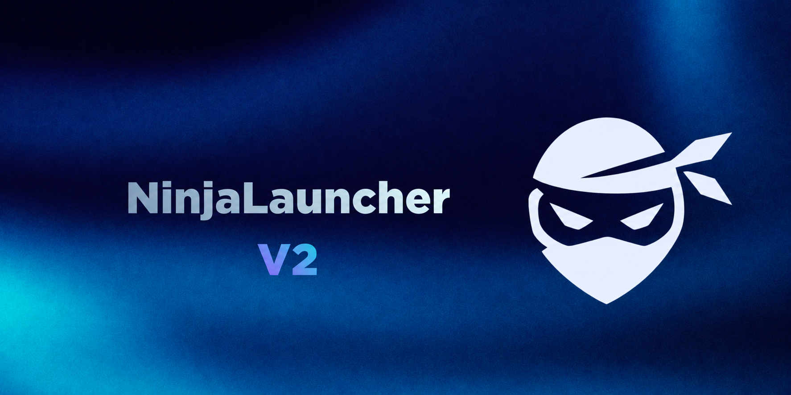
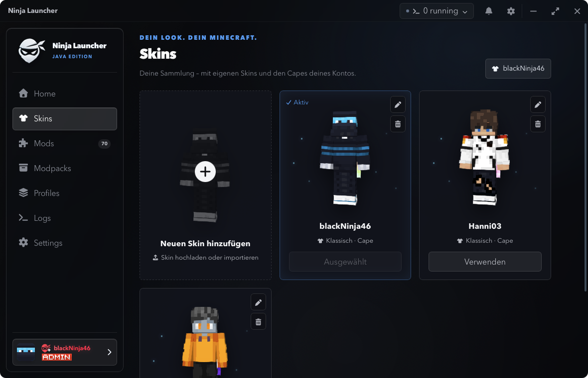

<div align="center">
  

  <h1>Ninja Launcher 2.0</h1>
  <p>A modern desktop launcher for Minecraft: Java Edition.</p>

[](https://github.com/blackNinja46/NinjaLauncher/releases/latest)
[](https://v2.tauri.app/)
[](https://www.rust-lang.org/)
[](https://svelte.dev/)
[](LICENSE)

[Download](https://github.com/blackNinja46/NinjaLauncher/releases/latest) ·
[Report a bug](https://github.com/blackNinja46/NinjaLauncher/issues/new) ·
[Request a feature](https://github.com/blackNinja46/NinjaLauncher/issues/new)
</div>

> [!IMPORTANT]
> Ninja Launcher 2.0 is under active development. Back up important worlds before testing a new
> release and report reproducible problems through GitHub Issues.

## What is Ninja Launcher?

Ninja Launcher is a cross-platform launcher for Minecraft: Java Edition. Version 2.0 combines
isolated Fabric and Vanilla profiles, Modrinth content, automatic Java management, Microsoft
accounts, multi-instance consoles, crash assistance, Dashboard-controlled content, and signed
launcher updates in one native application.

The interface is built with Svelte 5 and TypeScript. Authentication, downloads, dependency
resolution, profile storage, Java setup, and game launching are handled by a Rust backend through
Tauri 2.

## Highlights in 2.0

- **Redesigned home screen** with a rotatable 3D Minecraft skin, cape support, rank-aware nametag,
  profile selection, launch progress, and a visual Minecraft version picker.
- **Fabric and Vanilla profiles** with isolated game directories, flexible RAM allocation, custom
  Java runtimes, import/export tools, and editable copies of Modrinth modpacks.
- **Unified content management** for mods, resource packs, and shader packs, including local
  drag-and-drop files, enable/disable controls, type filters, and compatible version selection.
- **Full Modrinth browser** with search sorting, formatted project descriptions, galleries,
  versions, dependencies, and installation into the selected profile.
- **Improved launching and recovery** with managed Java runtimes, clearer Fabric diagnostics,
  automatic repair, rich crash dialogs, copyable reports, and optional Dashboard uploads.
- **Running-instance controls** in the title bar plus a separate console for every active Minecraft
  process.
- **Dashboard integration** for Minecraft catalogs, announcements, notification banners,
  maintenance mode, feature flags, ranks, and launcher releases.
- **New setup experience** for installation path, `.minecraft` import, Microsoft sign-in, privacy,
  appearance, accessibility, and the final launcher assembly animation.
- **Seasonal themes** such as the Dashboard-controlled Halloween event with an animated 3D scene
  and optional ambient sound effects.
- **Native platform polish** with dedicated macOS and Windows application icons, light/dark/system
  themes, reduced-animation support, and a custom title bar.

## Screenshots

<p align="center">
  
</p>

<table>
  <tr>
    <td width="33%" valign="top">
      
      <br><sub><b>Profiles</b> for isolated Fabric, Vanilla, and modpack installations.</sub>
    </td>
    <td width="33%" valign="top">
      
      <br><sub><b>Modrinth</b> content matched to the selected Minecraft version.</sub>
    </td>
    <td width="33%" valign="top">
      
      <br><sub><b>Skins and capes</b> with interactive previews and quick switching.</sub>
    </td>
  </tr>
</table>

## Minecraft and profile support

- **Fabric:** versions are sourced from the Fabric and Dashboard catalogs and sorted automatically.
- **Vanilla:** supported releases are available down through Minecraft 1.15.
- **Modrinth modpacks:** install `.mrpack` profiles directly or import a local pack by drag and
  drop. Pack-managed content is protected; create an editable copy before changing it.
- **Content:** compatible mods, resource packs, and shader packs can be installed from Modrinth or
  added locally.

Forge, NeoForge, Quilt, and Lunar Client profiles are not currently supported.

## Download

Installers are published on the
[GitHub Releases page](https://github.com/blackNinja46/NinjaLauncher/releases):

- **macOS:** `.dmg` for Apple Silicon and Intel Macs
- **Windows:** NSIS setup `.exe` for 64-bit Windows

Normal play requires a Microsoft account that owns Minecraft: Java Edition. Demo mode can be used
without an account for supported local testing.

> [!NOTE]
> Unsigned development builds can trigger Windows SmartScreen or a macOS security warning. Public
> releases should be code-signed, and macOS builds should be notarized before broad distribution.

## Automatic updates

Installed desktop builds can check for updates automatically at startup. The updater:

1. reads `latest.json` from the latest published GitHub release;
2. verifies the downloaded platform artifact with the updater public key embedded in the app;
3. downloads and installs the update; and
4. restarts Ninja Launcher.

Update checks can be disabled under **Settings → Application → Check for updates**. Development
builds started with `bun tauri dev` and the browser-only frontend do not install updates.

Only a published, non-draft stable GitHub release is served through `/releases/latest`. Draft and
prerelease builds therefore do not form a separate beta update channel.

## Development

### Prerequisites

- [Bun](https://bun.sh/)
- [Rust stable](https://www.rust-lang.org/tools/install)
- The platform dependencies from the
  [Tauri prerequisites guide](https://v2.tauri.app/start/prerequisites/)
  - macOS: Xcode Command Line Tools (`xcode-select --install`)
  - Windows: Microsoft C++ Build Tools with **Desktop development with C++** and WebView2

### Run locally

```sh
git clone https://github.com/blackNinja46/NinjaLauncher.git
cd NinjaLauncher
bun install
bun tauri dev
```

### Quality checks

```sh
bun run format:check
bun run check
bun run build

cd src-tauri
cargo test
cargo clippy --all-targets --all-features -- -D warnings
```

## Building installers

Installers should be built on their target operating system. The release workflow builds Apple
Silicon macOS, Intel macOS, and Windows x64 artifacts.

### macOS

```sh
bun install --frozen-lockfile
bun tauri build --bundles app,dmg
```

### Windows

```powershell
bun install --frozen-lockfile
bun tauri build --bundles nsis
```

Generated bundles are stored below `src-tauri/target/release/bundle/`.

## Publishing a 2.x release

The GitHub Actions release workflow runs for tags matching `app-v*` and initially creates a draft
release.

1. Set the same semantic version in `package.json`, `src-tauri/Cargo.toml`, and
   `src-tauri/tauri.conf.json`.
2. Configure `TAURI_SIGNING_PRIVATE_KEY` and `TAURI_SIGNING_PRIVATE_KEY_PASSWORD` as GitHub Actions
   secrets. The private key must match the public key in `src-tauri/tauri.conf.json`.
3. Push a matching tag, for example `app-v2.0.0`.
4. Test the generated macOS and Windows installers.
5. Publish the draft release and confirm that it contains `latest.json`, the updater archives, and
   their `.sig` files.

Existing installations will only discover the release after the draft has been published. Never
commit the updater private key or its password.

## Project structure

```text
NinjaLauncher/
├── src/                  # Svelte frontend and Tauri API bindings
├── src-tauri/src/        # Rust launcher backend
├── src-tauri/icons/      # Platform application icons
├── static/               # Runtime images, audio, and version artwork
├── docs/                 # Screenshots and Dashboard documentation
├── scripts/              # Asset and icon generation utilities
└── .github/workflows/    # Release automation
```

## Data and privacy

- Account tokens and launcher settings are stored locally in the operating system's application
  data directory.
- Microsoft passwords never pass through Ninja Launcher.
- Anonymous usage data is controlled in the launcher settings.
- Network requests are made to Microsoft, Xbox, Minecraft, Mojang, Fabric, Modrinth, Java runtime
  providers, the configured Ninja Dashboard, and GitHub Releases when required.
- Removing an account deletes its locally stored tokens.

Do not share account storage or copied crash reports without reviewing them first; they can contain
profile names, paths, and technical environment information.

## Contributing

Bug reports and focused pull requests are welcome. Before opening a pull request:

1. Explain the problem and expected behavior.
2. Keep unrelated changes out of the pull request.
3. Run the frontend and Rust quality checks.
4. Never commit accounts, signing keys, access tokens, or downloaded game files.

## Disclaimer

Ninja Launcher is an independent, unofficial project. It is not affiliated with or endorsed by
Microsoft, Mojang Studios, Minecraft, Fabric, or Modrinth. Minecraft is a trademark of Microsoft
Corporation. Users are responsible for following the Minecraft EULA and the terms of every service
used by the launcher.

## License

Ninja Launcher is available under the [MIT License](LICENSE).
