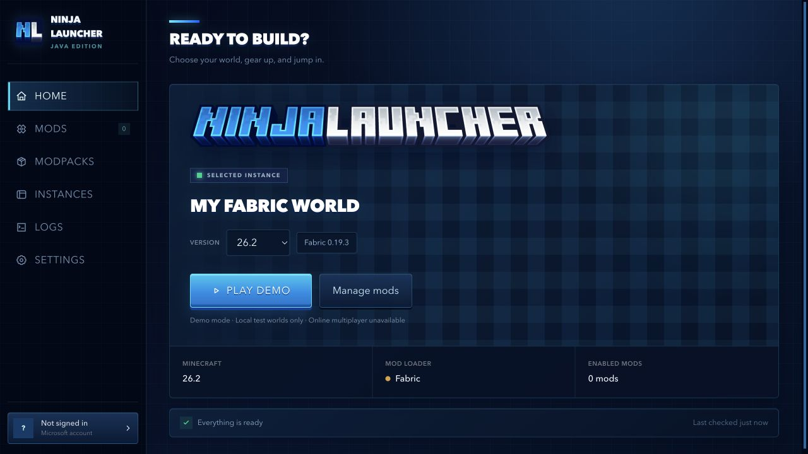
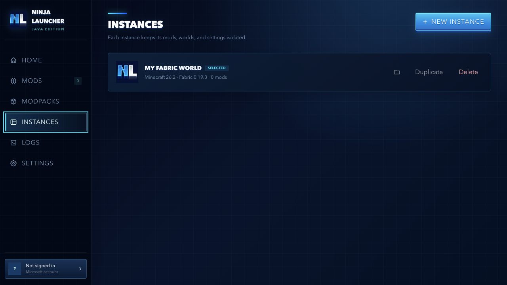
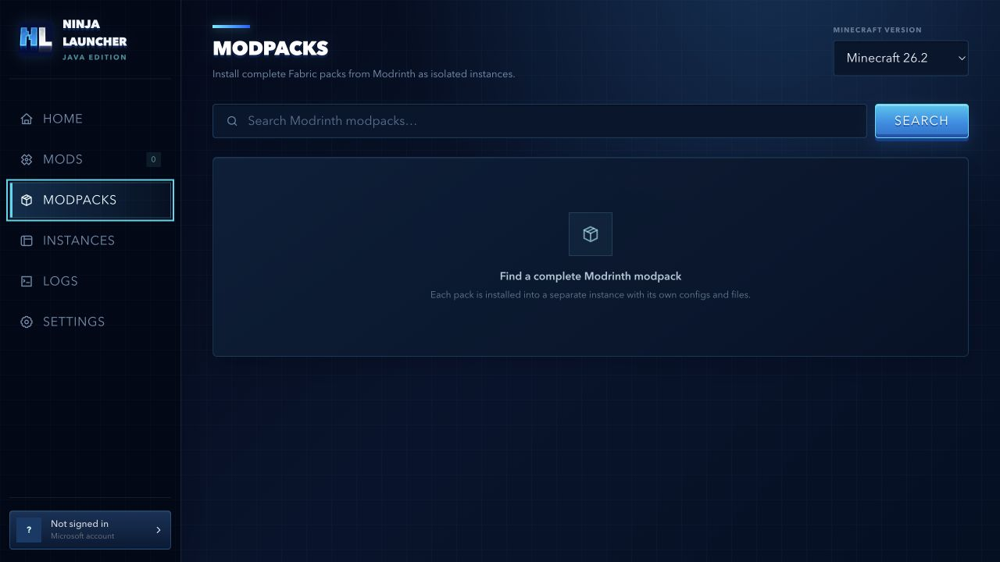
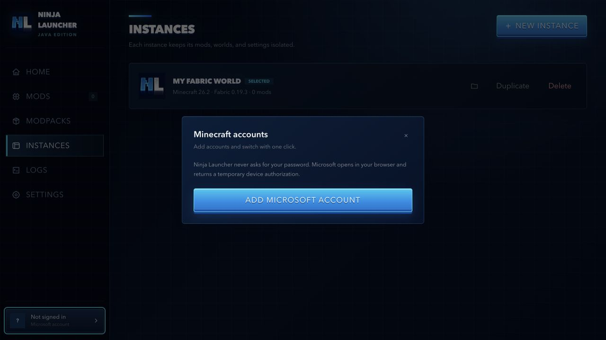

<div align="center">
  

  <p>A modern, Minecraft-inspired launcher for Minecraft: Java Edition.</p>

[](https://v2.tauri.app/)
[](https://www.rust-lang.org/)
[](https://svelte.dev/)
[](LICENSE)

[Download](https://github.com/blackNinja46/NinjaLauncher/releases/latest) ·
[Report a bug](https://github.com/blackNinja46/NinjaLauncher/issues/new) ·
[Request a feature](https://github.com/blackNinja46/NinjaLauncher/issues/new)
</div>

> [!IMPORTANT]
> Ninja Launcher is under active development. Back up important worlds before using development
> builds and please report reproducible problems through GitHub Issues.

## About

Ninja Launcher is a cross-platform desktop launcher for Minecraft: Java Edition. It combines
isolated Fabric instances, Modrinth integration, automatic Java management, Microsoft account
support, game logs, and launcher updates in one lightweight native application.

The interface is built with Svelte 5 and TypeScript, while downloads, authentication, instance
management, dependency resolution, and game launching are handled by a Rust backend through
Tauri 2.

## Screenshots

<p align="center">
  
</p>

<table>
  <tr>
    <td width="33%" valign="top">
      
      <br><sub><b>Isolated instances</b> with quick actions.</sub>
    </td>
    <td width="33%" valign="top">
      
      <br><sub><b>Modrinth modpacks</b> filtered by Minecraft version.</sub>
    </td>
    <td width="33%" valign="top">
      
      <br><sub><b>Microsoft accounts</b> through secure device-code sign-in.</sub>
    </td>
  </tr>
</table>

## Features

- **Multiple Minecraft accounts** — add Microsoft accounts, switch instantly, and remove them
  independently.
- **Isolated instances** — create, duplicate, configure, and delete separate Minecraft
  installations.
- **Minecraft launching** — downloads the official client, libraries, assets, and Fabric profile,
  then starts the selected instance.
- **Automatic Java setup** — detects a compatible Java runtime and installs a managed runtime when
  the required version is missing.
- **Modrinth mod browser** — searches compatible Fabric mods, displays project icons, and links to
  the corresponding Modrinth pages.
- **Mod management** — enable, disable, remove, and select a version override for each Minecraft
  version.
- **Dependency and conflict checks** — resolves required dependencies and highlights incompatible
  mod combinations before launch.
- **Modrinth modpacks** — searches for and installs compatible `.mrpack` Fabric modpacks into new
  managed instances.
- **Readable game logs** — optional launch-time log view with colors, category filters, and cleaned
  Log4j XML wrappers.
- **Demo mode** — test installation and launching without signing in.
- **Automatic launcher updates** — checks signed GitHub releases, installs an available update, and
  restarts the launcher.
- **Platform-specific desktop experience** — native macOS icon treatment and a custom Windows title
  bar without the extra Minecraft console window.

## Supported Minecraft versions

Ninja Launcher currently supports Fabric instances for:

- `1.21.11`
- `26.1`
- `26.1.1`
- `26.1.2`
- `26.2`

Forge, NeoForge, Quilt, and vanilla-only instances are not supported yet.

## Download

Prebuilt installers are published on the
[GitHub Releases page](https://github.com/blackNinja46/NinjaLauncher/releases):

- **macOS:** `.dmg` for Apple Silicon and Intel Macs
- **Windows:** NSIS setup `.exe` for 64-bit Windows

You need a Microsoft account that owns Minecraft: Java Edition for normal play. The built-in demo
mode can be used without an account.

> [!NOTE]
> Unsigned development builds can trigger Windows SmartScreen or a macOS security warning. Official
> public releases should be code-signed and macOS builds should be notarized before broad
> distribution.

## Development

### Prerequisites

- [Bun](https://bun.sh/)
- [Rust stable](https://www.rust-lang.org/tools/install)
- The platform dependencies from the
  [official Tauri prerequisites guide](https://v2.tauri.app/start/prerequisites/)
  - macOS: Xcode Command Line Tools (`xcode-select --install`)
  - Windows: Microsoft C++ Build Tools with **Desktop development with C++** and WebView2

### Run locally

```sh
git clone https://github.com/blackNinja46/NinjaLauncher.git
cd NinjaLauncher
bun install
bun tauri dev
```

### Quality checks

```sh
bun run format:check
bun run check
bun run build

cd src-tauri
cargo test
cargo clippy --all-targets --all-features -- -D warnings
```

## Build installers

Installers should normally be built on their target operating system. The included GitHub Actions
workflow builds both macOS architectures and a Windows NSIS installer automatically.

### macOS

```sh
bun install --frozen-lockfile
bun tauri build --bundles app,dmg
```

The artifacts are written below `src-tauri/target/release/bundle/`.

### Windows

Run the following in PowerShell or Windows Terminal:

```powershell
bun install --frozen-lockfile
bun tauri build --bundles nsis
```

The setup executable is written below `src-tauri\target\release\bundle\nsis\`.

Building a Windows installer directly on macOS is possible but requires additional cross-compiling
tools and has limitations. Using a Windows machine or the included GitHub Actions workflow is the
recommended route. See the
[official Tauri Windows installer guide](https://v2.tauri.app/distribute/windows-installer/) for
details.

## Microsoft authentication

Ninja Launcher uses Microsoft's OAuth device-code flow. The launcher never asks for or receives a
Microsoft password. After authentication it verifies the Xbox identity, Minecraft entitlement, and
Java Edition profile.

The application includes a public desktop OAuth client ID, so end users do not need to create their
own Microsoft Entra application. No client secret is embedded. Launcher maintainers can replace the
ID at compile time:

```sh
NINJA_MICROSOFT_CLIENT_ID="your-client-id" bun tauri build
```

An app registration must be configured correctly and approved for access to Minecraft Services;
an ordinary Entra client ID alone is not sufficient.

## Automatic updates and releases

The release workflow is triggered by tags matching `app-v*` and creates draft GitHub releases for:

- macOS Apple Silicon
- macOS Intel
- Windows x64 (NSIS)

Before publishing a release:

1. Set the same semantic version in `package.json`, `src-tauri/Cargo.toml`, and
   `src-tauri/tauri.conf.json`.
2. Add `TAURI_SIGNING_PRIVATE_KEY` to the repository's GitHub Actions secrets.
3. Keep the private updater key backed up securely and never commit it.
4. Commit the version change and push a matching tag, for example `app-v0.2.0`.
5. Test the generated installers, then publish the draft release.

Installed launchers with update checks enabled read the signed update manifest from the latest
published GitHub release.

## Project structure

```text
NinjaLauncher/
├── src/                  # Svelte frontend and Tauri API bindings
├── src-tauri/src/        # Rust launcher backend
├── src-tauri/icons/      # Platform application icons
├── static/brand/         # Launcher branding
├── docs/screenshots/     # README screenshots
├── scripts/              # Asset generation utilities
└── .github/workflows/    # Cross-platform release automation
```

## Data and privacy

- Account tokens and launcher settings are stored locally in the operating system's application
  data directory.
- Microsoft passwords never pass through Ninja Launcher.
- Network requests are made to Microsoft/Xbox/Minecraft services, Mojang metadata and asset hosts,
  Modrinth, Java runtime distribution hosts, and GitHub Releases as required by the selected action.
- Removing an account from the launcher deletes its locally stored tokens.

Do not share `account.json`; it contains authentication tokens.

## Contributing

Bug reports and focused pull requests are welcome. Before opening a pull request:

1. Explain the problem and the intended behavior.
2. Keep unrelated changes out of the pull request.
3. Run the frontend checks and Rust tests listed above.
4. Never commit account data, signing keys, access tokens, or downloaded game files.

## Disclaimer

Ninja Launcher is an independent, unofficial project. It is not affiliated with, endorsed by, or
approved by Microsoft, Mojang Studios, Minecraft, Fabric, or Modrinth. Minecraft is a trademark of
Microsoft Corporation. Users are responsible for complying with the Minecraft EULA and the terms
of every service used by the launcher.

## License

Ninja Launcher is available under the [MIT License](LICENSE).
